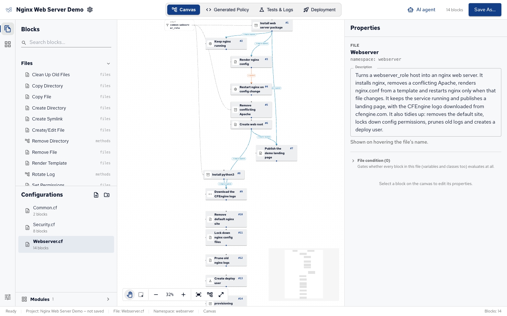
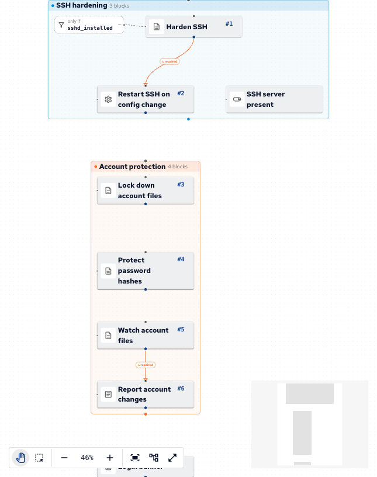
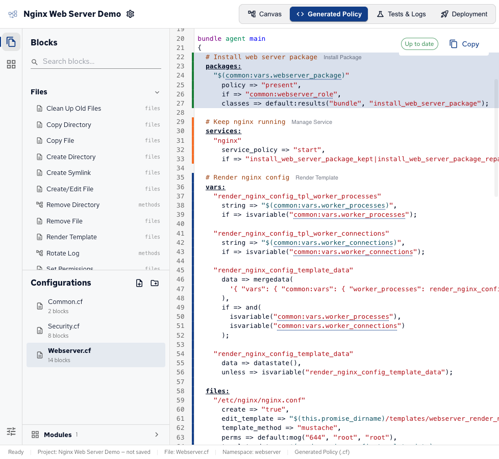
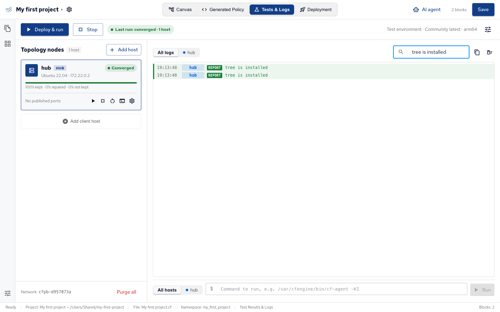
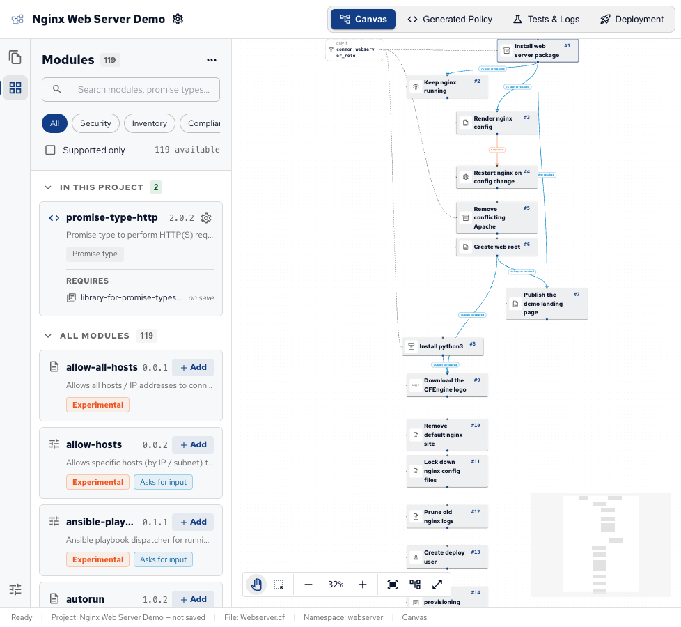
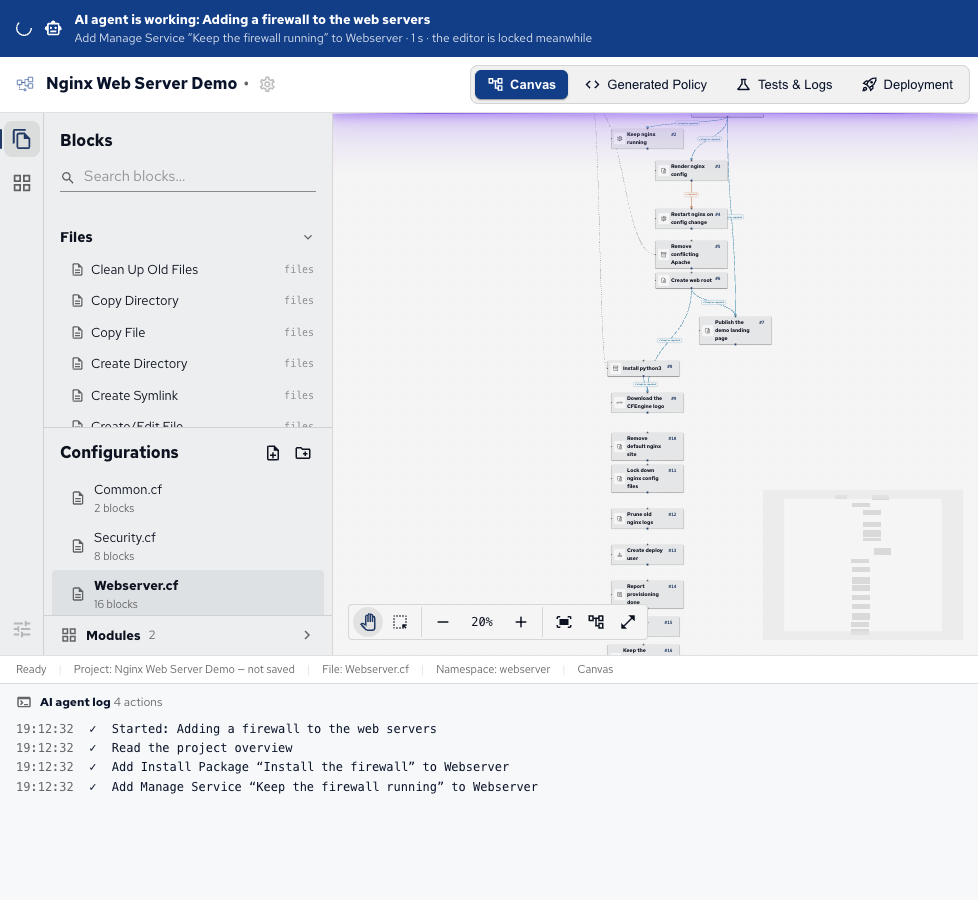
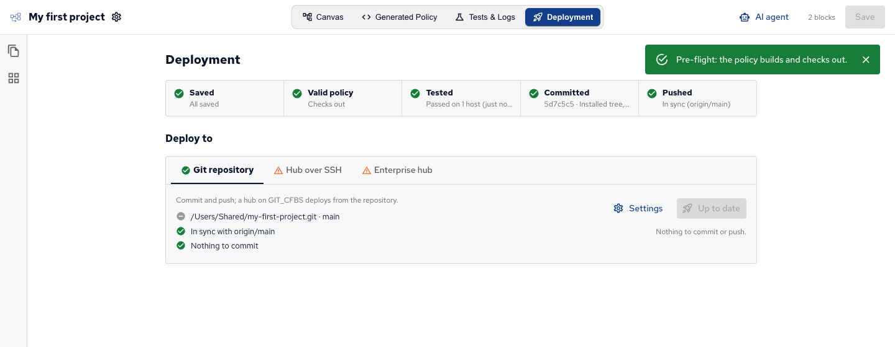

# CFEngine Policy Builder

[](https://github.com/cfengine/policy-builder/actions/workflows/ci.yml)
[](SECURITY-CHECKLIST.md)
[](https://app.codecov.io/gh/cfengine/policy-builder?flags%5B0%5D=typescript)
[](https://app.codecov.io/gh/cfengine/policy-builder?flags%5B0%5D=python)

Desktop application for building CFEngine policy: put blocks on a canvas, connect them with
arrows, and Policy Builder writes the policy, tests it on containers and ships it to your hub.
Installers are on the [Releases](https://github.com/cfengine/policy-builder/releases) page.



## A quick look

**Blocks on a canvas.** Each block is one thing a host should do: install a package, keep a
service running, render a config from a template. Arrows set the order, conditions limit a block
to certain hosts, and groups keep related blocks together.



**The policy it writes.** Generated Policy shows the exact CFEngine policy, the selected block's
lines highlighted. A project is a [cfbs](https://github.com/cfengine/cfbs) project.



**Tested on containers.** Run the policy on Docker containers and see each host converge, with
the agent's output.



**Modules from [CFEngine Build](https://build.cfengine.com).** Browse them, add them to the
project and answer their input.



**Built with an AI agent.** Policy Builder runs an MCP server, so agents such as Claude Code can
build the project while you watch, each change one undo step.



**Shipped to your hub.** Commit and push to the git repository your hub deploys from, or deploy
over SSH.



## Development

**Stack:** 
 - Electron 
 - React
 - TypeScript
 - MUI
 - Python (bundled sidecar for the CFEngine toolchain)

## Requirements

- Node.js 22.12+
- npm 10+
- uv - manages the Python sidecar and its interpreter, so no system Python is needed

## Getting started

```sh
npm ci               # install exactly the versions package-lock.json pins
npm run backend:sync # create python/.venv with the CFEngine toolchain
npm run dev          # launches Electron app
```

`npm run dev` needs the sidecar to exist, so `backend:sync` is a one-time
prerequisite. Without it, the app runs but anything touching the backend
reports that it cannot be found.

## Security

How the app follows Electron's security recommendations, item by item, and
how that is checked: [SECURITY-CHECKLIST.md](SECURITY-CHECKLIST.md).

## Project structure

electron-vite builds three targets from `src/`:

```
src/
├── main/      # Electron main process: window creation, ipcMain handlers
├── preload/   # contextBridge exposing `window.api`
└── renderer/  # React app
python/        # Python sidecar, packaged with PyInstaller
```

## The Python sidecar

Policy formatting, and later `cfbs` policy generation, local container testing
and the AI backend, run in a Python process bundled with the app — see
[python/README.md](python/README.md). Electron spawns it **once per user
action**, writes the policy to stdin and reads the result from stdout, the same
contract as `prettier` or `black --stdin`.

`npm run backend:build` freezes it with PyInstaller into
`python/dist/cfpb-backend/`, which `electron-builder` then ships in the app's
resources. The `build:*` scripts do that for you.

## Scripts

| Script                  | What it does                                               |
| ----------------------- | ---------------------------------------------------------- |
| `npm run dev`           | Dev app with hot reload                                    |
| `npm run build`         | Type-check then build main/preload/renderer bundles        |
| `npm start`             | Preview the production build                               |
| `npm run build:mac`     | Build sidecar + app, package for macOS (`dmg`, `zip`)      |
| `npm run build:win`     | Build sidecar + app, package a Windows installer (`nsis`)  |
| `npm run build:linux`   | Build sidecar + app, package Linux (`AppImage`,`deb`,`rpm`)|
| `npm run lint`          | ESLint (flat config)                                       |
| `npm run format`        | Prettier write                                             |
| `npm run typecheck`     | `tsc --noEmit` for node + web projects                     |
| `npm test`              | Vitest unit tests (jsdom)                                  |
| `npm run backend:sync`  | Install the sidecar's Python dependencies (uv)             |
| `npm run backend:build` | Freeze the sidecar with PyInstaller                        |
| `npm run backend:test`  | pytest                                                     |
| `npm run backend:format`| Black write                                                |
| `npm run backend:format:check` | Black check, as CI runs it                          |

## CI

GitHub Actions ([.github/workflows/ci.yml](.github/workflows/ci.yml)) runs
lint + format check, type check, unit tests, and the Python backend's own lint
and tests on every push and PR.

## Releases

Run **Actions → Prepare release → Run workflow** with the version (e.g. `0.2.0`),
whether it's a pre-release and whether to publish it straight away. It opens a
pull request "Version 0.2.0" bumping `package.json`; close and reopen it once to
run the checks (pull requests opened by a workflow don't start them). Merging it
runs [.github/workflows/release.yml](.github/workflows/release.yml): the merge
commit is tagged `v0.2.0`, the installers for macOS (arm64 and x64), Linux and
Windows are built and attached to the release, a draft unless publishing was
asked for. Pushing a `v0.2.0` tag by hand does the same as a draft pre-release.

The Windows installer of a release is signed by Northern.tech AS (Azure
Artifact Signing); its build waits for a reviewer to approve the
`windows-signing` deployment. macOS and Linux builds aren't code-signed
yet; the release notes say how to open them.
